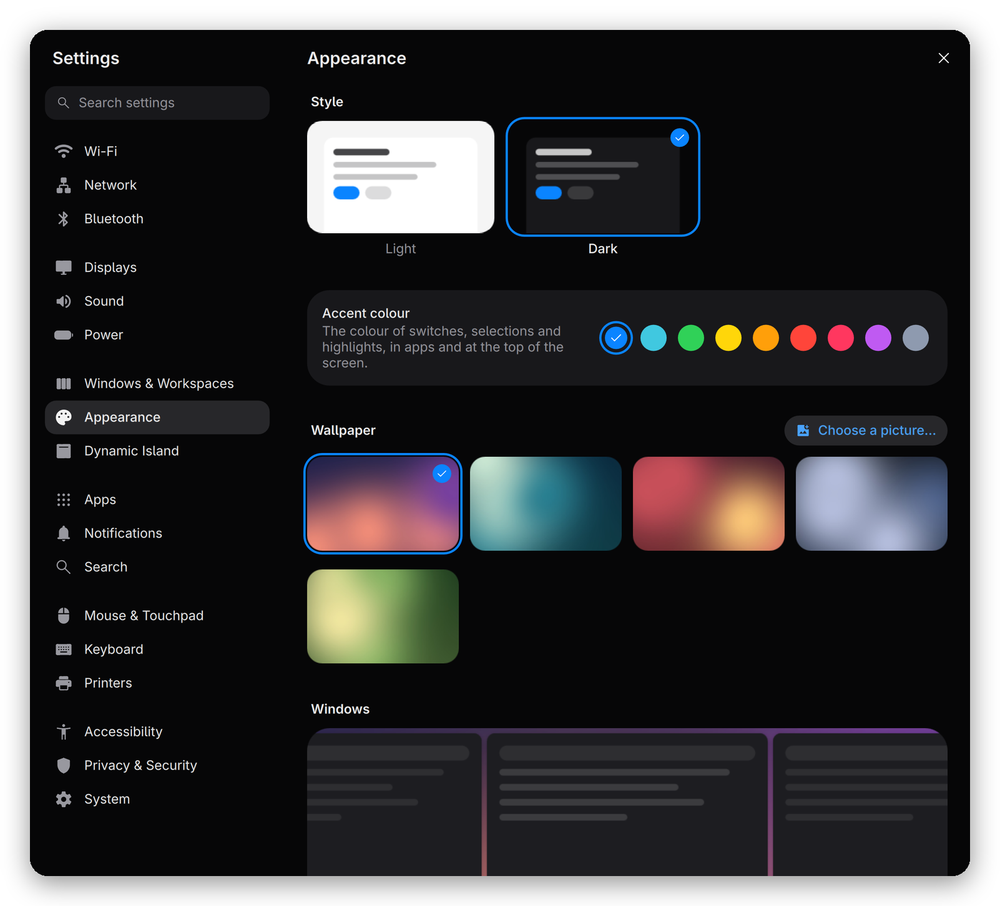
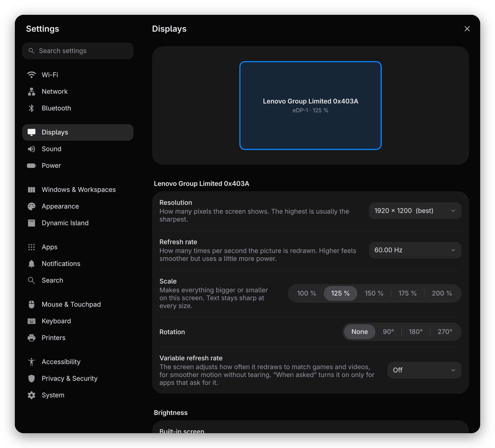
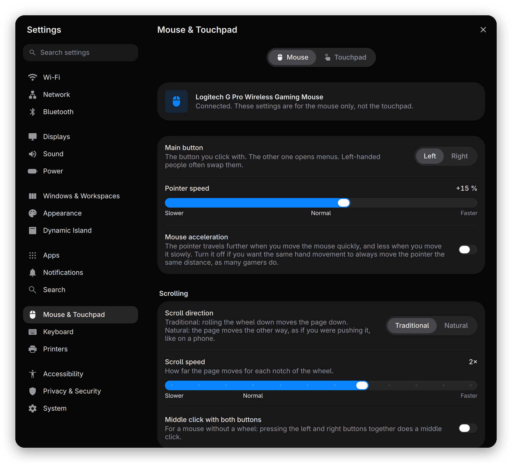
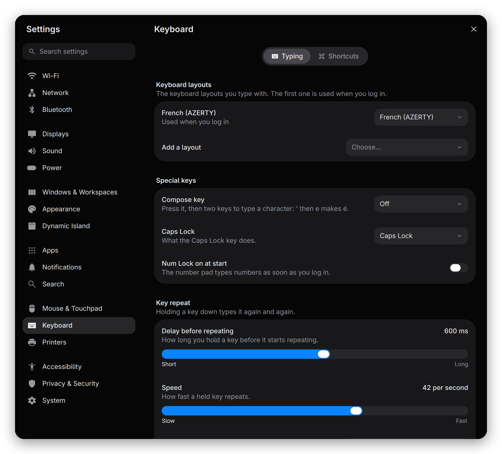
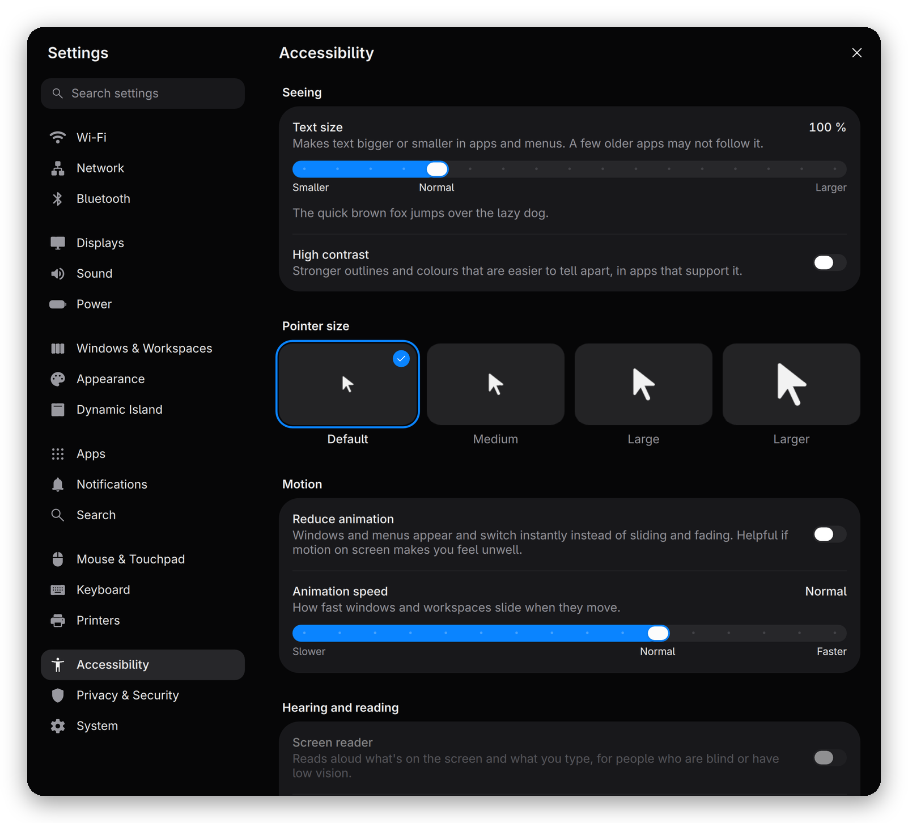
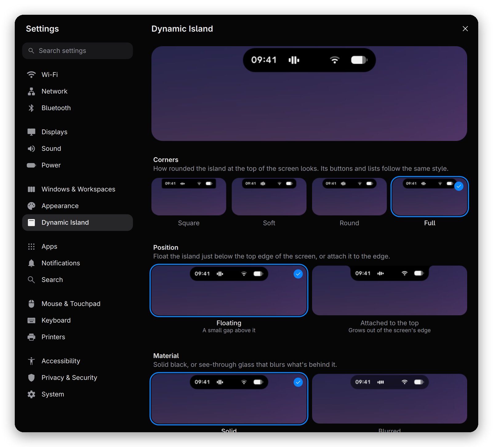

# niri-settings

A settings app for the [niri](https://github.com/YaLTeR/niri) Wayland compositor: niri, the system and
the [niri-island](https://github.com/NiteChill/niri-island) top bar in one window, the way GNOME
Settings is for GNOME. Built with [Quickshell](https://quickshell.org) (QML).

It is a community project, not part of niri.



## What it does

Pages: **Wi-Fi**, **Network** (wired, VPN, proxy), **Bluetooth**, **Displays** (resolution, scale,
rotation, main screen, brightness, night light), **Sound** (devices, volumes per app, microphone test),
**Power** (power mode, screen off, sleep), **Windows & Workspaces**, **Appearance** (light / dark,
accent colour, wallpaper, gaps, corners, borders, shadows, blur, fonts, icons, cursor),
**Dynamic Island**, **Apps** (default apps, startup apps), **Notifications**, **Search**,
**Mouse & Touchpad**, **Keyboard** (layouts, special keys, repeat, every shortcut), **Printers**,
**Accessibility**, **System** (about, date & time, region, users), **Privacy & Security**.

- The important settings are shown; niche ones sit in each page's Advanced group; the rest stay in
  config files.
- niri's settings go in a file of its own, `~/.config/niri/settings.kdl`, which your `config.kdl`
  includes: your own config stays yours. Every change is checked with niri before it's applied, and a
  change niri refuses is undone.
- The system's settings (accent, clock, fonts, Focus...) are written where every app reads them
  (gsettings), so GTK apps and the island follow along.
- It follows its own settings: text size, high contrast, reduced animation, the interface font and the
  scroll speed apply to the app itself.
- A search across every setting; `settings <page> [setting]` opens one directly.
- Other apps' "settings" buttons (Files' Trash Settings...) open the matching page.
- Pages say what's missing on your computer (no Bluetooth service, no printer support...) and offer to
  install it.

| | |
|---|---|
|  |  |
|  |  |

## Works with niri-island

[niri-island](https://github.com/NiteChill/niri-island) is a Dynamic Island-style top bar for niri,
made to go with this app. Each works without the other; together:

- The **Dynamic Island** page sets the island's look (corner style, attached to the top, blur), which
  alerts show and what its search finds; island options also appear where you'd look for them
  (notification behaviour under Notifications, alert sounds under Sound, wallpapers under Appearance).
- Both follow the system's settings: the accent colour, the 12 / 24-hour clock, Focus and the wallpaper
  set in one show in the other.
- The island's search finds this app's settings ("night light" opens that page), and clicking a system
  notification in the island opens the matching page here.
- Keyboard > Shortcuts lists the island's actions (search, quick settings, panels, volume and
  brightness keys) next to niri's.

Without the island, its options are hidden and the Dynamic Island page shows what it is.




## What you need

Required:

| What | Fedora | Arch |
|---|---|---|
| niri (tested with 26.04) | `niri` | `niri` |
| Quickshell 0.3 or newer | [COPR `errornointernet/quickshell`](https://copr.fedorainfracloud.org/coprs/errornointernet/quickshell/) | `quickshell` (AUR) |
| GLib tools, dconf and the desktop's setting schemas | `glib2`, `dconf`, `gsettings-desktop-schemas` | `glib2`, `dconf`, `gsettings-desktop-schemas` |
| Python 3 | `python3` | `python` |

Used by some pages (each page says when something is missing, and offers to install it):

| For | Fedora | Arch |
|---|---|---|
| Wi-Fi, Network | `NetworkManager` | `networkmanager` |
| Bluetooth | `bluez` | `bluez` |
| Sound | `pipewire-utils`, `wireplumber` | `pipewire`, `wireplumber` |
| Battery, power mode | `upower`, `tuned-ppd` (or `power-profiles-daemon`) | `upower`, `power-profiles-daemon` |
| Brightness (laptops) | `brightnessctl` | `brightnessctl` |
| Wallpaper, screen off, lock, night light | `swaybg`, `swayidle`, `swaylock`, `wlsunset` | same names |
| Users, fingerprints | `accountsservice`, `fprintd` | `accountsservice`, `fprintd` |
| Printers | `cups-client`, `system-config-printer` | `cups`, `system-config-printer` |
| Fonts, default apps | `fontconfig`, `xdg-utils` | `fontconfig`, `xdg-utils` |
| Opening from other apps' settings buttons | `python3-gobject` | `python-gobject` |

Optional: the **Google Sans Flex** font
([Google Fonts](https://fonts.google.com/specimen/Google+Sans+Flex)) for the island's matching look,
and [niri-island](https://github.com/NiteChill/niri-island).

`settings --doctor` lists what your computer has and lacks, with the package names for Fedora, Arch,
Debian / Ubuntu and openSUSE.

## Install

```sh
git clone https://github.com/NiteChill/niri-settings ~/.local/share/niri-settings
~/.local/share/niri-settings/install.sh
```

It shows up as **Settings** in your app launcher (with Wi-Fi, Bluetooth, Displays, Sound and Dynamic
Island as quick actions) and adds a `settings` command (`settings wifi` opens a page). It ends with
`settings --doctor`. On its first start the app adds one line at the end of
`~/.config/niri/config.kdl` that includes its own `settings.kdl`.

To try it without installing: `qs -p ~/.local/share/niri-settings`.

**Update:** `git -C ~/.local/share/niri-settings pull`.
**Uninstall:** `~/.local/share/niri-settings/install.sh --uninstall`, then delete the folder (and the
`include` line at the end of `config.kdl` if you want niri to forget the app's choices).

If you move the folder, run `install.sh` again.

## Development

- `theme/Theme.qml`: every colour, size, corner and animation, from HeroUI v3's default theme, and how
  the app follows the desktop's settings.
- `components/`: HeroUI v3's components rebuilt on QtQuick.Templates (which handle keyboard, focus,
  hover and press, the way React Aria does for HeroUI), plus the settings pieces.
- `services/`: niri's config (KDL), gsettings, the island's config, hardware (Wi-Fi, Bluetooth, sound,
  power) and the machine (time, region, user, apps).
- `pages/`: the window layout (`App.qml`) and the pages.
- `assets/icons/`: Material Symbols Rounded (`name.svg` outlined, `name-fill.svg` filled).
- `bin/settings`, `data/` (desktop entry, icon), `install.sh`: the app as an installed app.
  `bin/settings-doctor.py`: the dependency check.
- `inventory.md`: every setting the app covers, and where it's stored.
- `tools/capture-island.py`, then `tools/readme-images.py`: the README images of both projects (the
  island staged with made-up data, this app in a sandbox).

Test without touching your system: `SETTINGS_SANDBOX=<dir>` with copies of niri's config in
`<dir>/niri` and the island's in `<dir>/island` (changes are logged, not applied), and
`DCONF_PROFILE` pointing at a test database.

## Licence

GNU General Public License v3.0 or later: see `LICENSE`. The icons (Material Symbols) and the design
values taken from HeroUI v3 are Apache-2.0: see `THIRD-PARTY.md`.
